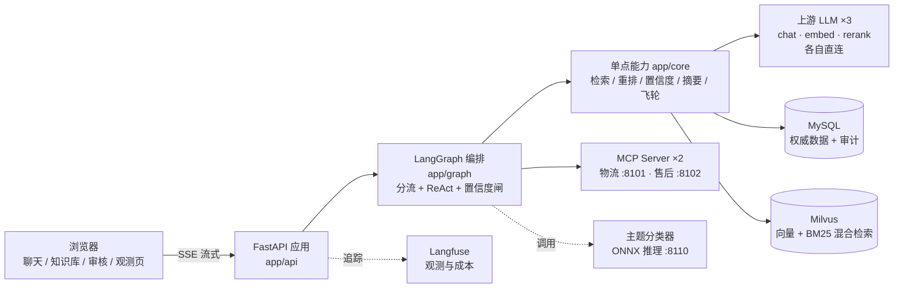

# ShopMate — 电商智能客服 Agent

[](https://github.com/mayixiao472/shopmate/actions)
[](https://www.python.org/)
[](https://github.com/mayixiao472/shopmate/actions)

一个能查订单物流、答政策 FAQ、走退款子流程、挖知识补库、还能微调一个主题分类器的完整客服系统。

项目按 10 个迭代里程碑开发：从一个纯流式对话接口起步，逐步长出工具调用、RAG 知识库、
Agent 编排、可观测性与数据飞轮，最后收尾于自训练的文本主题分类器。

> 本项目基于一门 AI Agent 实战课程练手开发，仅供学习交流与面试展示，不授权任何商用。

## 技术栈

FastAPI + LangGraph / LangChain + SQLAlchemy / MySQL + Milvus。

聊天、嵌入、重排三组上游各自直连，没有网关那一层。模型名和地址都在 `.env` 里配
（`CHAT_*` / `EMBED_*` / `RERANK_*` 三组），换供应商、换模型不用改代码。

## 架构



## 功能

- 流式对话：SSE 逐字渲染，支持中断、上下文续接、结构化提取
- 工具调用：5 个业务 `@tool`（订单、物流、FAQ、退款、工单），单轮 Function Calling 与 ReAct 多步 Agent 双模式
- RAG 知识库：切块、嵌入、MySQL/Milvus 双写、混合检索 + RRF + 重排、Query 改写、对话挖问答对
- 意图识别：分流器、指代消解、退款子流程 interrupt/resume
- 上下文管理：滑窗、摘要、提示词前缀缓存
- 工具系统：MCP 动态发现、统一执行引擎、审计日志
- 可观测性：自部署 Langfuse、成本账、数据飞轮（低置信度问答人工复核后回灌知识库）
- 主题分类器：语料构建、微调、阈值扫描、ONNX 推理服务

## 跑起来

```bash
cp .env.example .env      # 填 CHAT_* / EMBED_* / RERANK_* 三组
docker compose up -d      # MySQL + Milvus
make seed                 # 灌业务测试数据
make dev                  # MCP :8101/:8102 + 应用 :8000
```

浏览器打开 <http://localhost:8000> 就是聊天页。

## 代码怎么组织

| 位置 | 装的是什么 |
| - | - |
| `app/api/` | HTTP 入口。聊天、Agent、知识库录入、复核、验收页、成本看板 |
| `app/graph/` | LangGraph 那张图。`state` 状态、`nodes` 节点、`routing` 分流规则、`build` 组装 |
| `app/core/` | 单点能力。上游客户端、检索、重排、意图、指代、摘要、置信度、飞轮、可观测 |
| `app/kb/` | 知识怎么进库。切块、嵌入、双写 MySQL 与 Milvus、去重、从对话里挖问答对 |
| `app/tools/` | 工具系统。内置 `@tool`、MCP 客户端、注册表、统一执行引擎 |
| `app/db/` | 表模型与仓储 |
| `app/static/` | 前端页面。聊天、知识库录入、飞轮待审、观测与成本、主题分布、分类器验收 |
| `mcp_servers/` | 两台业务 MCP Server，物流和售后各一台，独立进程 |
| `sql/` | 各里程碑的建表与迁移，容器首启按文件名顺序自动执行 |
| `scripts/` | 建库、评估、微调这些离线活 |

## 迭代里程碑

`make test` 跑全部单测，不打真实模型。下面这些要真服务在跑。

| 里程碑 | 长出来的东西 | 验收 |
| - | - | - |
| ch01 | 流式对话、结构化提取 | `make eval` |
| ch02 | 五个 `@tool` 业务工具，单轮 Function Calling | `make eval-agent` |
| ch03 | 切块、嵌入、MySQL 与 Milvus 双写、对话挖知识 | `make kb-build` `make kb-vectorize` `make eval-retrieval` |
| ch04 | 混合检索、RRF、重排、Query 改写、四策略评估 | `make smoke-rag` `make eval-rag` |
| ch05 | LangGraph workflow 骨架 + 主力 Agent 的 ReAct 环 | `make eval-ch05` |
| ch06 | 分流器、指代消解、退款子流程的 interrupt/resume | `make smoke-interrupt` `make eval-ch06` |
| ch07 | 上下文管理。滑窗、摘要、前缀缓存 | `make eval-ch07` |
| ch08 | 工具系统。MCP 动态发现、统一执行引擎、审计日志 | `make eval-ch08` |
| ch09 | Langfuse 自部署、数据飞轮、成本账 | `make langfuse-up` `make flywheel` `make eval-flywheel` `make cost-report` |
| ch10 | 主题分类器。语料、微调、阈值扫描、ONNX 推理服务 | `make ch10-corpus` `make ch10-train` `make ch10-eval` |

`make help` 能看到带说明的完整目标清单。

## 设计决策

三篇「为什么这么做」的短文,与代码一一对应,评审/面试前可先读:

- [上下文管理与前缀缓存](docs/design/prefix-cache-context.md) —— 单条恒定 SystemMessage + 双层滑窗 + 后台摘要;含 22.4s→1.4s 的成本实测
- [检索链路](docs/design/retrieval-pipeline.md) —— 切块 / 双写 / 混合检索 + RRF / 重排 / 改写;含四桶 300 题评估实测
- [置信度闸门与数据飞轮](docs/design/confidence-flywheel.md) —— 零成本四信号置信度 + 落池 → 审核 → 回灌闭环

## 界面预览

> 运行截图占位,待补充:聊天页(多轮 + 工具调用标记)、观测页(成本账)。

## 端口

| 端口 | 是什么 |
| - | - |
| 8000 | 应用 |
| 8101 / 8102 | 业务 MCP Server，物流 / 售后 |
| 8110 | ch10 主题分类器推理服务（`make classifier-up` 之后） |
| 3000 | Langfuse（`make langfuse-up` 之后） |
| 19530 | Milvus |

应用那几个页面：`/` 聊天、`/kb` 知识库录入、`/review` 飞轮待审、`/observability` 观测与成本、
`/topics` 主题分布、`/acceptance` 分类器验收。
